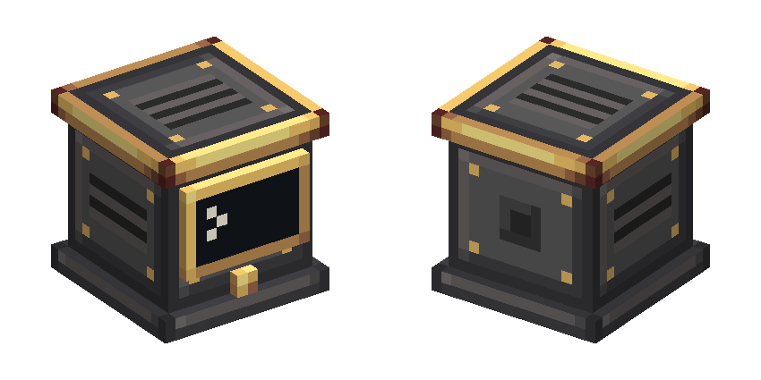

# Avionics Computer — fonte visual (v2.1, ferro industrial + latão; ex-GPWS Computer)

Guia obrigatório: [guia visual v2.1](../../docs/visual-design-guide.md). Referências diretas:
navigation table (Simulated), stockpile switch (Create), peças de ferro industrial do
Aeronautics. **Sem madeira** neste bloco, por decisão de 2026-10-28.

Abra `avionics_computer.bbmodel` no Blockbench (Java Block/Item, 1.21.1, *Box UV* desligado).

 

## Identidade

- **Material:** ferro industrial dominante (base, corpo, topo); latão só no acabamento
  (faixa da tampa, aro do topo, rebites, moldura da tela, botão). É o inverso do
  Advanced Terrain Scanner, que é latão por fora com miolo de ferro.
- **Peça funcional:** tela na frente (NORTH), inspirada no computador do CC:Tweaked: tela
  quase preta numa moldura de latão, com o prompt `>`. A tela muda com o estado do computador (veja "Estados da tela"). Embaixo, o botão de teste.
- **Redstone:** não há saída de redstone.
- **Laterais:** duas venezianas de ventilação. **Traseira:** socket de dados (seção 8.3).
- **Topo:** chapa de ferro com aro de latão, grade de ventilação e rebites.

## Peças

| Elemento | Volume | Material |
| --- | --- | --- |
| `base` | `[0,0,0]–[16,2,16]` | Rodapé de ferro; topo e fundo com `create:block/industrial_iron_block` |
| `body` | `[1,2,1]–[15,14,15]` | Chapa de ferro com moldura, rebites de latão, venezianas (laterais) e socket (traseira). Faces de cima e de baixo desligadas (encostam na tampa e na base) |
| `lid` | `[0,14,0]–[16,16,16]` | Faixa de latão; topo `avionics_computer_top`; fundo `create:block/brass_casing` (só o anel externo de latão aparece) |
| `screen` | `[2,5,0]–[14,13,1]` | Frente `avionics_computer_screen` (moldura de latão + tela de lente escura); bordas de latão no atlas |
| `test_button` | `[7,2,0]–[9,4,1]` | Botão de latão |

Cinco cubos, coordenadas inteiras, sem rotação.

## Texturas (1 texel = 1 unidade)

- `avionics_computer.png` (32×32): bordas da tela (12×1 e 1×8) e botão 2×2 + bordas (canto
  superior esquerdo), lateral 14×12 em `[16,0]`, traseira 14×12 em `[0,16]`, frente 14×12
  em `[14,16]`, faixa da tampa 16×2 em `[0,28]`, rodapé 16×2 em `[0,30]`.
- `avionics_computer_top.png` (16×16): topo da tampa. UVs dobradas no `.bbmodel` (espaço de
  UV único de 32).
- `avionics_computer_screen.png` (16×16): frente da tela, 12×8 no canto, só com o prompt.
  Modelo base, usado pelo item.
- Uma textura por estado da tela, todas desenhadas em [`screens.mjs`](screens.mjs):
  - `avionics_computer_screen_normal` (16×32 + `.mcmeta`, 8 ticks por quadro): o cursor `_`
    do CC:Tweaked piscando depois do prompt;
  - `avionics_computer_screen_caution` (16×32, 6 ticks): `!` âmbar piscando (tons claros do
    latão, guia §9.4);
  - `avionics_computer_screen_warning` (16×32, 4 ticks): `!` vermelho piscando (rampa de
    redstone), também no autoteste;
  - `avionics_computer_screen_inop` (16×16): `x` âmbar fixo.
- `create:block/industrial_iron_block` e `create:block/brass_casing`: texturas do Create,
  referenciadas por id e carregadas do jar dele em runtime. Para vê-las no Blockbench, use
  as cópias locais em `reference/create-textures/` (fora do git).

100% dos pixels próprios estão na paleta (ferro industrial, metal escuro, latão, lente
escura, redstone; prompt e cursor no tom mais claro do pergaminho).

## Estados da tela

`AvionicsComputerBlock.SCREEN` (`normal`, `caution`, `warning`, `inop`) é só visual. O
tick do servidor o mantém igual ao estado geral do computador (`AvionicsComputerStatus`):
alerta vence atenção, que vence INOP. O blockstate escolhe `avionics_computer_<estado>`, que
tem a mesma geometria e troca só a textura da tela (`AvionicsComputerAssetsTest` confere). A
técnica é a do CC:Tweaked (`computer_blink`), mas os pixels são nossos.

O botão de teste é funcional: `AvionicsComputerBlock.hitsTestButton` reconhece o clique no
botão (com meio texel de folga) em qualquer direção.

## Exportação

Salve o `.bbmodel` com as texturas incorporadas. Depois, na raiz do mod:

```powershell
node blockbench/avionics-computer/export-assets.mjs
```

O exportador grava `models/block/avionics_computer.json` e as quatro variantes de estado, os
PNGs do nosso namespace e os `.mcmeta` das texturas animadas, e falha com rotação,
coordenada fracionária ou face fora de 1:1. `create-base-model.mjs` é só o bootstrap da
v2.1: não o rode sobre uma fonte já refinada no Blockbench. `migrate-v2.2.mjs` foi a
migração única de 2026-10-28 (renomear as texturas e trocar as telas); já foi aplicada.

## Mudou a geometria?

Atualize `NORTH_SHAPE` e `hitsTestButton` em `AvionicsComputerBlock` e rode
`AvionicsComputerAssetsTest` (regras do guia, nomes dos cubos, tela na frente, variantes de
estado, botão e colisão igual ao modelo nas quatro direções). O computador não é
`CableSocketProvider`: o cabo encosta em qualquer face.

## Pendente

- Refino no Blockbench (a fonte ainda é a saída do bootstrap).
- Validação no jogo: quatro direções, cabo nas faces, inventário/mãos, ao lado de casings
  do Create, com e sem shader.
- Ver as quatro telas no jogo e o botão de teste com o clique (só verificados por testes e
  pela leitura dos pixels exportados).
