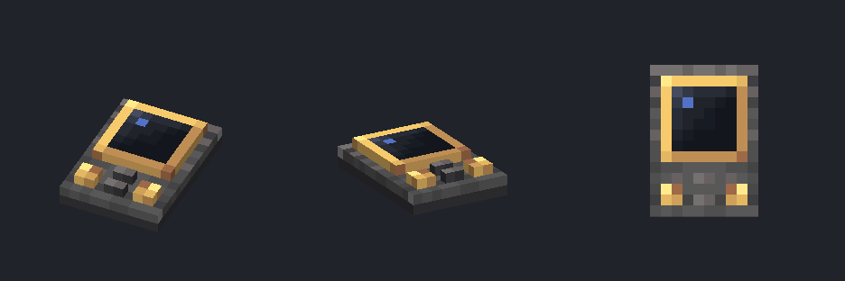
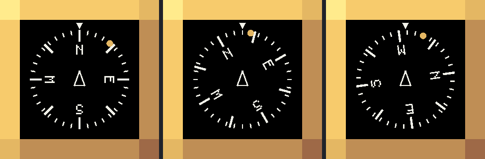

# Módulo FMS 2×3 — fonte visual (v2.1, ferro industrial + latão)

Guia obrigatório: [guia visual v2.1](../../docs/visual-design-guide.md), seção 9.
Referências: navigation table do Simulated, nixie tube e display link do Create.

Abra `fms_module_2x3.bbmodel` no Blockbench (Java Block/Item, 1.21.1, *Box UV* desligado,
resolução 32×32). Modelado com a mesa voltada para cima: apoio em Y = 0, centro em X/Z = 8.
Z baixo é o topo do painel (longe do piloto): a tela fica em cima e os controles embaixo.



## Identidade

Um console simples em vez da réplica de um FMS real: carcaça de ferro industrial, uma tela
de lente escura numa moldura de latão, dois knobs de latão e duas teclas. O latão fica só na
moldura e nos knobs. Sem teclado, sem teclas de seleção de linha, sem texto.

**Relevo de 1 unidade:** todo detalhe (tela, knobs, teclas) sobe exatamente 1 acima da
carcaça. A tela e a moldura são um único cubo; a moldura é pintada no topo dele.

## Bússola da tela

Com um waypoint selecionado (travado), a lente fica preta e mostra uma **rosa de bússola** no
estilo de um indicador de proa (HSI). Sem destino, a lente volta à textura normal.



- **Rosa de 360°:** marca curta a cada 10° e marca longa e grossa nos **8 pontos** (N, NE,
  E, SE, S, SW, W, NW). Só os cardeais têm letra (N, E, S, W); os colaterais ficam só com a
  marca. Letras e marcas em branco (`#F2F2EA`); as letras giram com a rosa, com o topo para
  fora, como num HSI.
- **Letras como geometria:** glifos 5×7 no estilo da fonte do Minecraft, desenhados como quads
  no mesmo passe das marcas. A fonte do jogo usa outro pipeline de texto, que brigava em
  profundidade com a lente conforme o ângulo da câmera e com shaders.
- **Proa:** a rosa gira para que a proa do FMS fique sob o índice fixo no topo. A proa é a
  direção do topo da tela no plano horizontal; em mesa de parede (topo da tela vertical), é a
  direção para dentro do painel. Dentro de uma contraption do Sable, usa a pose interpolada de
  render (`ClientSubLevel.renderPose(partialTick)`), então gira junto e sem tremer.
- **Triângulo central:** contorno branco, fixo, apontando para o índice: é o próprio FMS.
- **Waypoint:** dot de latão (`#E4B763`), centrado na faixa das marcas curtas, no
  rumo do FMS até o waypoint. Some se o waypoint estiver em outra dimensão.
- **Escala:** tudo em unidades do modelo, fixo em relação à lente de 6×6: raio 2,45, índice
  0,32, marcas de grau 0,16 e dos pontos 0,49, letras de 0,5 com centro a 1,5, triângulo 0,72
  de altura, dot de 0,34 de diâmetro. Nada depende da distância nem da resolução.
- **Performance:** a geometria das marcas é calculada uma vez (`FmsCompass`); por quadro só
  entram senos da proa e cerca de 130 quads (marcas, letras, dot, triângulo), sem alocação. A entrada dura 0,5 s (a rosa
  cresce de 85% a 100% e acende).
- Desenhado pelo `ModularTableRenderer` (`FmsCompassRenderer`), sem luz do mundo. Testes em
  `FmsCompassTest` (marcas, rumo, proa no chão, teto, paredes e com a contraption girada).
- Exceção à paleta e à grade de pixels registrada no guia (seção 9.4): é conteúdo de display.

## Peças

| Elemento | Volume | Material |
| --- | --- | --- |
| `housing` | `[3,0,1]–[13,2,15]` | `create:block/industrial_iron_block` (recortes 1:1) |
| `screen` | `[4,2,2]–[12,3,10]` | topo 8×8: moldura de latão de 1 px + lente escura 6×6; laterais de latão |
| `knob_left`, `knob_right` | `[4,2,12]–[6,3,14]`, `[10,2,12]–[12,3,14]` | latão, marca de ponteiro no topo |
| `key_upper`, `key_lower` | `[7,2,11]–[9,3,12]`, `[7,2,13]–[9,3,14]` | tampo de ferro industrial claro |

Seis cubos, coordenadas inteiras, sem rotação. Carcaça de 10×14, altura máxima 3 (guia, 9.2).
Faces escondidas (fundo dos detalhes) ficam no arquivo como desativadas (`texture: null`): o
Blockbench 5.2 não abre um `.bbmodel` com face faltando.

## Texturas

- `fms_module.png` (32×32): topo da tela com a moldura, laterais de latão, knobs e teclas. Regiões em `UV` no `create-base-model.mjs`.
- `create:block/industrial_iron_block`: referenciada pelo id, nunca copiada. Para vê-la no
  Blockbench, extraia o PNG do jar do Create para `reference/create-textures/` (fora do git).
  Também é a partícula.

## Exportação

```powershell
node blockbench/fms-module-2x3/export-assets.mjs
```

Gera `models/block/fms_module_2x3.json` e `textures/block/fms_module.png`. Falha com rotação,
coordenada fracionária ou face fora de 1:1. `create-base-model.mjs` é só o bootstrap: não o
rode sobre uma fonte já refinada no Blockbench.

O modelo de item (`models/item/fms_module.json`) herda o de bloco. Mudou a geometria? Rode
`FmsAssetsTest`. O módulo não tem colisão própria (fica na mesa).

## Pendente

- Refino de pixels no Blockbench: a fonte atual é a do bootstrap. Conferido no Blockbench web
  5.2.2: abre com os 6 cubos e `Codecs.java_block.compile()` bate com o export.
- Validação no jogo: mesa no chão, parede e teto, saves legados 2×2 (o renderer achata a
  profundidade), transformações de item e shaders. `preview.png` é um render local
  simplificado (sem AO nem iluminação do jogo).
- Bússola: validação no jogo (sentido de giro numa contraption, mesa de parede e teto, nitidez
  das letras a 1–2 blocos, saves 2×2 onde a lente achata, shaders). `compass-preview.png` é
  uma emulação local, não um print do jogo.
