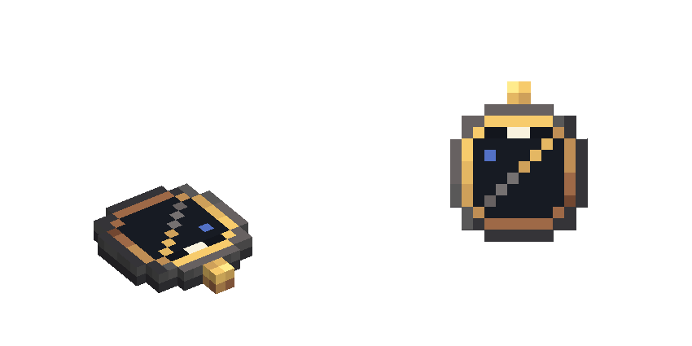
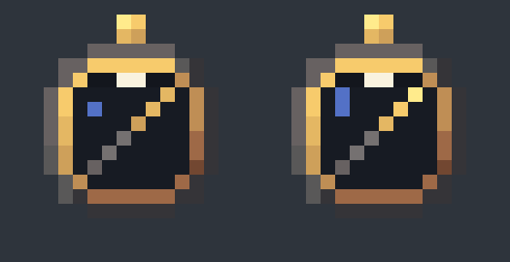

# FMS Compass — fonte visual (v2.1, ferro industrial + latão)

Item `fms_navigator`. Guia obrigatório: [guia visual v2.1](../../docs/visual-design-guide.md),
seção 9. Segue a linguagem do [módulo FMS](../fms-module-2x3/README.md), do qual é a versão de
bolso.

Abra `fms_navigator.bbmodel` no Blockbench (Java Block/Item, 1.21.1, *Box UV* desligado,
resolução 32×32). Modelado deitado: apoio em Y = 0, disco centrado em X/Z = 8, alça no norte
(Z baixo).



## Identidade

- **Lê como uma bússola do Minecraft:** um disco redondo com um ponteiro diagonal, do
  sudoeste (cauda de ferro) para o nordeste (ponta de latão), como a bússola vanilla em
  repouso. No inventário aparece chapado de cima, como o sprite dela.
- **Face na linguagem do FMS:** aro de ferro industrial, bezel de latão, lente escura com o
  reflexo azul e o índice branco no norte (o mesmo índice da bússola da tela do FMS).
- **Redondo em degraus:** cinco placas inteiras formam um disco de 12 de diâmetro, cujo
  contorno coincide pixel a pixel com o círculo pintado no topo. Nada de rotação.
- **De bolso:** uma alça de latão na borda norte.
- O ponteiro é pintado: no inventário fica parado; na Navigation Table o disco inteiro gira
  com a seta da mesa, de modo que o ponteiro aponta para o waypoint
  (`client/FmsNavigatorTableRenderer.java`, que conta com o ponteiro a 45° do +X).

## Estado ligado (`fms_navigator_linked`)

Quando o compasso está ligado a um módulo FMS, o item troca para o modelo
`fms_navigator_linked`: mesma geometria, mesma lista de texturas, só o atlas muda (o padrão
`_powered` dos sensores, guia §8.5). A mudança é sutil, de propósito, e fica toda dentro da lente:

- a cabeça de latão do ponteiro acende, com a ponta no tom mais claro da rampa (`8 → 7 → 6`
  no lugar de `6 → 6 → 5`): o ponteiro está "vivo";
- o reflexo azul da lente cresce de 1 para 2 pixels, como lente acesa.

Aro, bezel, índice, cauda de ferro do ponteiro e alça não mudam. No código, a propriedade de
item `aeronautics_fly_by_instruments:linked` (`client/FmsClient.java`) vale 1 com o item ligado,
e o override em `models/item/fms_navigator.json` aponta para `item/fms_navigator_linked`. O
override também vale na Navigation Table, que desenha o item pelo modelo.



## Peças

| Elemento | Volume | Material |
| --- | --- | --- |
| `disc` | `[2,0,5]–[14,2,11]` | topo: recorte da face pintada; laterais e fundo: `create:block/industrial_iron_block` |
| `disc_north`, `disc_south` | `[3,0,3]–[13,2,5]`, `[3,0,11]–[13,2,13]` | idem |
| `disc_north_cap`, `disc_south_cap` | `[5,0,2]–[11,2,3]`, `[5,0,13]–[11,2,14]` | idem |
| `lug` | `[7,0,0]–[9,2,2]` | alça de latão |

Seis cubos, coordenadas inteiras, sem rotação. As faces que encostam numa placa vizinha ficam
desativadas (`texture: null`).

## Texturas (1 texel = 1 unidade)

- `fms_navigator.png` (16×16): face 12×12 em `[0,0]` (cada placa usa o recorte dela, com
  `u = x − 2`, `v = z − 2`), alça 2×2 em `[12,0]` e `[14,0]`. UVs dobradas no `.bbmodel`
  (espaço de UV único de 32).
- `fms_navigator_linked.png` (16×16): cópia do atlas acima com só 4 pixels da lente trocados
  (estado ligado).
- `create:block/industrial_iron_block`: referenciada pelo id, nunca copiada. As laterais usam
  as linhas 14–16, com a borda escura, como a carcaça do FMS. Também é a partícula.

## Exportação

```powershell
node blockbench/fms-navigator/export-assets.mjs
```

Gera `models/block/fms_navigator.json`, `models/block/fms_navigator_linked.json` e os PNGs dos dois
atlas. Os modelos de item (`models/item/fms_navigator.json` e `fms_navigator_linked.json`) herdam
esses modelos e só definem as transformações de exibição (iguais nos dois) e o override `linked`.
`create-base-model.mjs` é só o bootstrap: não o rode sobre uma fonte já refinada no Blockbench.
Testes: `FmsAssetsTest.navigatorIsARoundCompassInTheFmsLanguage` e
`FmsAssetsTest.linkedNavigatorOnlySwapsTheAtlas`.

## Pendente

- Refino no Blockbench (a fonte é a saída do bootstrap).
- Validação no jogo: inventário, mão em primeira e terceira pessoa, chão e moldura de item. As
  transformações não foram vistas no jogo.
- Ponteiro vivo no inventário (como a bússola vanilla aponta para o spawn): exigiria variantes de
  ângulo do ponteiro e uma propriedade de item no cliente. Se o ponteiro pintado mudar de ângulo,
  ajuste `NEEDLE_OFFSET` em `FmsNavigatorTableRenderer`.
- Validação no jogo do estado ligado: se a diferença se lê no inventário (16 px) sem chamar
  atenção demais.
- Validação no jogo do compasso sobre a Navigation Table (altura sobre o tampo, giro).
