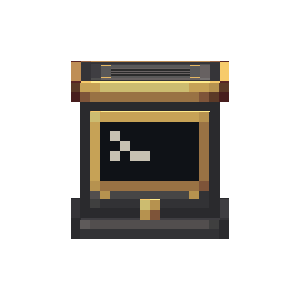

# GPWS Computer — fonte visual (v2.1, ferro industrial + latão)

Guia obrigatório: [guia visual v2.1](../../docs/visual-design-guide.md). Referências diretas:
navigation table (Simulated), stockpile switch (Create), peças de ferro industrial do
Aeronautics. **Sem madeira** neste bloco, por decisão de 2026-10-28.

Abra `gpws_computer.bbmodel` no Blockbench (Java Block/Item, 1.21.1, *Box UV* desligado).

 

## Identidade

- **Material:** ferro industrial dominante (base, corpo, topo); latão só no acabamento
  (faixa da tampa, aro do topo, rebites, moldura da tela, botão). É o inverso do
  Advanced Terrain Scanner, que é latão por fora com miolo de ferro.
- **Peça funcional:** tela na frente (NORTH), inspirada no computador do CC:Tweaked: tela
  quase preta numa moldura de latão, com o prompt `>`. Com o GPWS **armado**, um cursor `_`
  pisca depois do prompt. Embaixo, o botão de teste.
- **Redstone:** não há saída de redstone.
- **Laterais:** duas venezianas de ventilação. **Traseira:** socket de dados (seção 8.3).
- **Topo:** chapa de ferro com aro de latão, grade de ventilação e rebites.

## Peças

| Elemento | Volume | Material |
| --- | --- | --- |
| `base` | `[0,0,0]–[16,2,16]` | Rodapé de ferro; topo e fundo com `create:block/industrial_iron_block` |
| `body` | `[1,2,1]–[15,14,15]` | Chapa de ferro com moldura, rebites de latão, venezianas (laterais) e socket (traseira). Faces de cima e de baixo desligadas (encostam na tampa e na base) |
| `lid` | `[0,14,0]–[16,16,16]` | Faixa de latão; topo `gpws_computer_top`; fundo `create:block/brass_casing` (só o anel externo de latão aparece) |
| `screen` | `[2,5,0]–[14,13,1]` | Frente `gpws_computer_screen` (moldura de latão + tela de lente escura); bordas de latão no atlas |
| `test_button` | `[7,2,0]–[9,4,1]` | Botão de latão |

Cinco cubos, coordenadas inteiras, sem rotação.

## Texturas (1 texel = 1 unidade)

- `gpws_computer.png` (32×32): bordas da tela (12×1 e 1×8) e botão 2×2 + bordas (canto
  superior esquerdo), lateral 14×12 em `[16,0]`, traseira 14×12 em `[0,16]`, frente 14×12
  em `[14,16]`, faixa da tampa 16×2 em `[0,28]`, rodapé 16×2 em `[0,30]`.
- `gpws_computer_top.png` (16×16): topo da tampa. UVs dobradas no `.bbmodel` (espaço de
  UV único de 32).
- `gpws_computer_screen.png` (16×16): frente da tela, 12×8 no canto, só com o prompt.
- `gpws_computer_screen_armed.png` (16×32 + `.mcmeta`, 8 ticks por quadro): textura animada
  de dois quadros, com e sem o cursor. Só a variante `gpws_computer_armed.json` usa.
- `create:block/industrial_iron_block` e `create:block/brass_casing`: texturas do Create,
  referenciadas por id e carregadas do jar dele em runtime. Para vê-las no Blockbench, use
  as cópias locais em `reference/create-textures/` (fora do git).

100% dos pixels próprios estão na paleta (ferro industrial, metal escuro, latão, lente
escura; prompt e cursor no tom mais claro do pergaminho).

## Estado armado

`GpwsComputerBlock.ARMED` é só visual. O tick do servidor o mantém igual a
`mode == ARMED`, inclusive depois de recarregar o mundo, quando o modo volta a `STANDBY`.
O blockstate escolhe `gpws_computer_armed`, que tem a mesma geometria e troca só a textura
da tela (`GpwsAssetsTest` confere). A técnica é a do CC:Tweaked (`computer_blink`), mas os
pixels são nossos.

## Exportação

Salve o `.bbmodel` com as texturas incorporadas. Depois, na raiz do mod:

```powershell
node blockbench/gpws-computer/export-assets.mjs
```

O exportador grava `models/block/gpws_computer.json`, `gpws_computer_armed.json`, os PNGs do
nosso namespace e o `.mcmeta` da textura animada, e falha
com rotação, coordenada fracionária ou face fora de 1:1. `create-base-model.mjs` é só o
bootstrap da v2.1: não o rode sobre uma fonte já refinada no Blockbench.

## Mudou a geometria?

Atualize `NORTH_SHAPE` em `GpwsComputerBlock` e rode `GpwsAssetsTest` (regras do guia,
nomes dos cubos, tela na frente, variante armada e colisão igual ao modelo nas quatro
direções). O GPWS
não é `CableSocketProvider`: o cabo encosta em qualquer face.

## Pendente

- Refino no Blockbench (a fonte ainda é a saída do bootstrap).
- Validação no jogo: quatro direções, cabo nas faces, inventário/mãos, ao lado de casings
  do Create, com e sem shader.
- Ver o cursor piscando no jogo (a animação e a troca de estado só foram verificadas por
  testes e render do quadro com cursor).
