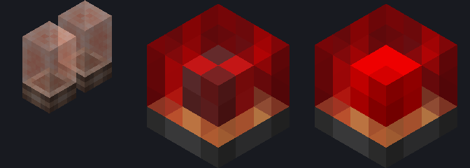

# Módulo de lâmpada 1×1 — fonte visual (v2.1, tubo nixie)

Guia obrigatório: [guia visual v2.1](../../docs/visual-design-guide.md), seção 9 (módulos da
mesa). Referências diretas: nixie tube e lâmpada de sinal de trem (Create).

Abra `lamp_module_1x1.bbmodel` no Blockbench (Java Block/Item, 1.21.1, *Box UV* desligado,
resolução 32×32). Modelado com a mesa voltada para cima: apoio em Y = 0, centro em X/Z = 8.



## Identidade

- **Soquete** opaco de metal escuro, como a base do nixie. O aro de latão fica no topo do
  soquete e aparece através do vidro.
- **Tubo de vidro** vermelho translúcido, sem face inferior. Alpha por pixel: miolo claro
  (0x48) para o filamento aparecer, bordas (0x80) e coluna de reflexo do lado iluminado (0xB0)
  mais densas, para ler como cilindro.
- **Filamento** dentro do vidro: malha de metal escuro apagada e xadrez de redstone acesa,
  como a lâmpada de sinal de trem.

## Peças

| Elemento | Volume | Textura |
| --- | --- | --- |
| `socket` | `[6,0,6]–[10,1,10]` | `lamp_socket` |
| `glass` | `[6,1,6]–[10,4,10]` | `lamp_glass_red` (sem face `down`) |
| `filament` | `[7,1,7]–[9,3,9]` | `lamp_filament_off` / `lamp_filament_on` (sem face `down`) |

Três cubos, coordenadas inteiras, sem rotação. Carcaça de 4×4×4 (guia, seção 9.2).

## Texturas (1 texel = 1 unidade, 16×16)

- `lamp_socket.png`: lateral 4×1, topo 4×4 (aro de latão), fundo 4×4.
- `lamp_glass_red.png`: lateral 4×3 e topo 4×4, a única textura translúcida.
- `lamp_filament_off.png` e `lamp_filament_on.png`: lateral 2×2 e topo 2×2, nas mesmas
  posições.

As mesmas texturas servem à [lâmpada 2×1](../lamp-module-2x1/README.md), com regiões extras
para as faces longas. Os mapas de pixel das duas ficam em `lamp-textures.mjs`, e esta fonte é
a dona dos PNGs: a 2×1 só confere se a cópia dela é igual.

Os nomes das texturas são contrato com `LampModuleRenderer`, que separa as faces pelo
sprite: soquete no passe opaco; vidro e filamento no passe emissivo quando a lâmpada está
acesa.

## Âmbar (2026-10-28)

A lâmpada tem duas cores, escolhidas pela indicação na mesa (`LampIndication`): vermelho
para Alerta GPWS e âmbar para Atenção GPWS e GPWS INOP. O âmbar é o **mesmo mapa** do
vermelho em [`lamp-textures.mjs`](lamp-textures.mjs), com as chaves de redstone trocadas
pelos tons de latão (R→5, S→6, T→7, U→8) e o mesmo alpha:

- `lamp_glass_amber.png`: vidro âmbar, que mantém a cor apagado;
- `lamp_filament_on_amber.png`: filamento aceso em âmbar, senão o vermelho atrás do vidro
  âmbar ficaria laranja. O filamento apagado é o mesmo.

As duas texturas estão incorporadas nas fontes 1×1 e 2×1 (`add-amber.mjs`, migração única
já aplicada). O exportador grava `_amber_off` e `_amber_on`; o item escolhe o modelo por
`custom_model_data` (0 vermelho apagado, 1 vermelho aceso, 2 âmbar apagado, 3 âmbar aceso),
e `LampModuleRenderer` reconhece os dois vidros e os dois filamentos acesos.
`LampModuleAssetsTest` confere que o âmbar só troca vidro e filamento e mantém o alpha.
Pendente: ver as duas cores no jogo, com e sem shader.

## Exportação

```powershell
node blockbench/lamp-module-1x1/export-assets.mjs
```

Gera `lamp_module_1x1_off.json`, `lamp_module_1x1_on.json` (só troca o filamento), as
variantes `_amber_off`/`_amber_on` e os PNGs,
com `render_type` translúcido. Falha com rotação, coordenada fracionária ou face fora de
1:1. `create-base-model.mjs` é só o bootstrap: não o rode sobre uma fonte já refinada no
Blockbench.

O modelo de item (`models/item/lamp_module.json`) herda o bloco e amplia a lâmpada na GUI,
no chão, na moldura e nas mãos.

Mudou a geometria? Rode `LampModuleAssetsTest` e confira `PanelCoordinates.MODULE_TOP`
(topo do volume de seleção, 4 unidades acima da mesa).

## Pendente

- Refino de pixels no Blockbench: a fonte atual é a do bootstrap.
- Validação no jogo: emissão de 0 a 15 (`docs/lamp-emission.md`), mesa no chão, parede e
  teto, transformações de item e shaders. `preview.png` é um render local simplificado, sem o
  passe emissivo.
