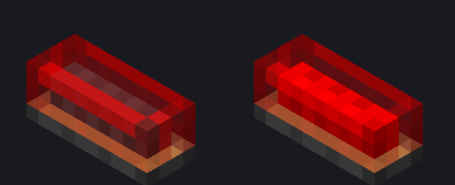

# Módulo de lâmpada 2×1 — fonte visual (v2.1, tubo nixie horizontal)

Guia obrigatório: [guia visual v2.1](../../docs/visual-design-guide.md), seção 9. Mesma
linguagem da [lâmpada 1×1](../lamp-module-1x1/README.md), que é a referência visual.

Abra `lamp_module_2x1.bbmodel` no Blockbench (Java Block/Item, 1.21.1, *Box UV* desligado,
resolução 32×32). Modelado com a mesa voltada para cima, ao longo do eixo X local: apoio em
Y = 0, centro em X/Z = 8. O renderer gira o modelo 90° quando o footprint é 1 coluna × 2
linhas.



## Identidade

A 1×1 em versão longa, como um tubo deitado: soquete de metal escuro com aro de latão,
vidro vermelho sem face inferior e um filamento comprido. Como o eixo do tubo é X, o reflexo
do vidro corre ao longo da linha de cima das faces longas, e não numa coluna como na 1×1. As
pontas (leste e oeste) usam as mesmas regiões das faces da 1×1. A variante âmbar
(`_amber_off`/`_amber_on`) usa as mesmas texturas âmbar da 1×1; veja
[Âmbar](../lamp-module-1x1/README.md#âmbar-2026-10-28).

## Peças

| Elemento | Volume | Textura |
| --- | --- | --- |
| `socket` | `[3,0,6]–[13,1,10]` | `lamp_socket` |
| `glass` | `[3,1,6]–[13,4,10]` | `lamp_glass_red` (sem face `down`) |
| `filament` | `[4,1,7]–[12,3,9]` | `lamp_filament_off` / `lamp_filament_on` (sem face `down`) |

Três cubos, coordenadas inteiras, sem rotação. Carcaça de 10×4×4 (guia, seção 9.2).

## Texturas

As texturas são as mesmas da 1×1 (`lamp_socket`, `lamp_glass_red`, `lamp_filament_*`), que
têm regiões próprias para as faces longas. Os mapas de pixel ficam em
`../lamp-module-1x1/lamp-textures.mjs`. **A fonte da 1×1 é a dona dos PNGs:** o exportador da
2×1 não grava texturas, só confere, pixel a pixel, se as cópias incorporadas neste `.bbmodel`
são iguais às exportadas. Ao repintar no Blockbench, pinte na 1×1, exporte-a e depois
atualize as texturas deste projeto.

## Exportação

```powershell
node blockbench/lamp-module-1x1/export-assets.mjs
node blockbench/lamp-module-2x1/export-assets.mjs
```

Gera `lamp_module_2x1_off.json` e `lamp_module_2x1_on.json` (só troca o filamento), com
`render_type` translúcido. `create-base-model.mjs` é só o bootstrap: não o rode sobre uma
fonte já refinada no Blockbench.

O modelo de item (`models/item/lamp_module_2x1.json`) amplia a lâmpada na GUI, no chão, na
moldura e nas mãos. Mudou a geometria? Rode `LampModuleAssetsTest`.

## Pendente

- Refino de pixels no Blockbench: a fonte atual é a do bootstrap.
- Validação no jogo: emissão de 0 a 15, as duas orientações (2×1 e 1×2), mesa no chão,
  parede e teto, transformações de item e shaders. `preview.png` é um render local
  simplificado, sem o passe emissivo.
