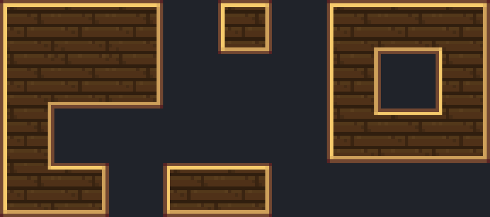

# Base da mesa modular — fonte visual (v2.1, latão + madeira escura)

Guia obrigatório: [guia visual v2.1](../../docs/visual-design-guide.md), seções 9.3 (família de
material) e 8.3 (motivos). Referências diretas: navigation table do Simulated e o brass casing
do Create (moldura que se conecta entre blocos vizinhos).

Abra `modular_table_base.bbmodel` no Blockbench (Java Block/Item, 1.21.1, *Box UV* desligado,
resolução 32×32, texturas de 16 px com UVs dobradas). Modelado voltado para cima; o blockstate
gira para chão, parede e teto.



## Identidade

- **Tampo** de tábuas horizontais de madeira escura (3 px + junta de 1 px, emendas alternadas).
- **Moldura** de latão de 2 px: contorno no 2º tom, bisel claro em cima/esquerda e mais escuro
  embaixo/direita (o motivo de casing dos scanners).
- **Lateral** em faixa de latão de 4 px com rebites a cada 8 px, sem arremate nas pontas.
- **4 px de espessura** (`PanelCoordinates.SURFACE`): o corpo de 4 px do Wire Connector encaixa
  na borda.
- **Tampo rente**, sem moldura em relevo: os módulos apoiam em Y = 4 e as células da borda
  ficam sobre a moldura, então um aro saliente atravessaria a carcaça deles.

## Texturas conectadas

Mesas lado a lado no mesmo plano e na mesma face (`FACING` igual) formam um painel só: a
moldura contorna o conjunto, inclusive em L e em volta de furos. É o layout CTM "compacto":

| Textura (16×16) | Quando entra num quarto do tampo |
| --- | --- |
| `modular_table_top` | Nenhum vizinho nos dois lados do quarto (também é o item e a partícula) |
| `modular_table_top_horizontal` | Vizinho só no eixo U da textura |
| `modular_table_top_vertical` | Vizinho só no eixo V |
| `modular_table_top_inner` | Vizinhos nos dois lados e diagonal vazia (canto côncavo) |
| `modular_table_top_wood` | Vizinhos nos dois lados e na diagonal |

`ModularTableModels` (cliente) divide a face de cima em quatro quartos e escolhe a textura de
cada um com `TableConnections.tile`; as laterais voltadas para outra mesa somem. A madeira é
função só do pixel, por isso quartos de texturas diferentes emendam sem costura. Nenhum estado
de bloco novo: a conexão é lida dos vizinhos na montagem do chunk.

- `modular_table_side.png`: faixa da lateral nas linhas 0–3 (16×4); o resto repete a faixa.
- O fundo usa `modular_table_top_wood` e é cortado contra o suporte (`cullface: down`).

Os nomes das texturas são contrato com `ModularTableModels` e `ModularTableAssetsTest`.

## Exportação

```powershell
node blockbench/modular-table-base/export-assets.mjs
node blockbench/modular-table-base/preview.mjs
```

O exportador grava `modular_table_base.json` e os seis PNGs (as quatro texturas de conexão não
aparecem nas faces, mas o atlas de blocos inclui tudo em `textures/block/`). `preview.mjs`
monta um arranjo de mesas com a mesma regra dos quartos. `create-base-model.mjs` é só o
bootstrap, e os mapas de pixel ficam em `table-textures.mjs`: não rode o bootstrap sobre uma
fonte já refinada no Blockbench.

Mudou a geometria? Atualize as formas em `ModularTableBaseBlock` e rode
`ModularTableAssetsTest` e `ModularTableBaseBlockTest`. Mudou a espessura? Confira também
`PanelCoordinates` e o `ModularTableRenderer`.

## Pendente

- Refino de pixels no Blockbench: a fonte atual é a do bootstrap.
- Validação no jogo: conexão em chão, parede e teto, mesas em sublevel do Aeronautics, com e
  sem shader. `preview.png` é um render local de cima, sem luz nem AO.
- Mesas em faces diferentes (chão + parede) não se conectam; quinas entre elas mostram as duas
  molduras.
